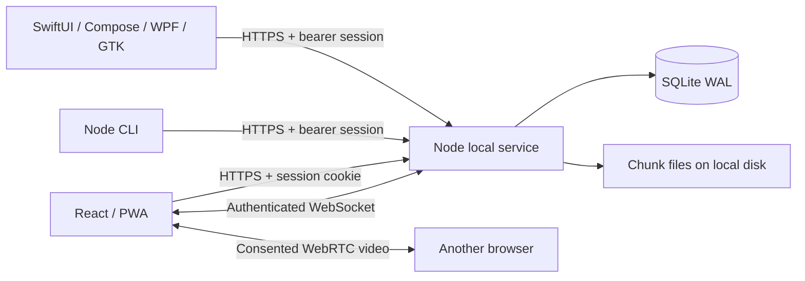

# Architecture of this release

The service is a shared local host. All clients speak the same HTTP/JSON protocol; native clients poll while foregrounded, and the web client also uses WebSocket invalidations and signaling. A service can run on any host with Node 24. It does not require internet connectivity after dependencies are installed.

`server/store.js` creates the schema and handles metadata audit chaining. `server/app.js` owns authentication, origin checks, pairing, permissions, clipboard, transfers, and screen sessions. `server/collaboration.js` owns CRDT synchronization, tasks, file requests, and presence.

Each upload is a metadata offer followed by explicit-offset chunks. The service verifies each SHA-256 checksum, writes at the committed offset, syncs the file, then advances the database offset. Re-offering the same filename, size, hash, sender, and recipient resumes an incomplete upload. Completion streams the file through a whole-file hash and atomically renames it. Startup repairs the rename/commit crash window by returning the file to the partial state for re-verification.

All stored files use generated UUID paths. User filenames appear only as metadata and download names. A transfer has an optional target ID; its content and metadata are available only to the sender, target, or everyone when deliberately shared workspace-wide. Owner status alone does not expose a targeted file in ordinary APIs.

The scratchpad uses Yjs updates, not last-write-wins text replacement. The client stores its document in IndexedDB and uploads merged state after reconnecting. The service validates changes against a bounded candidate document, persists the merged snapshot, and returns the merged state to clients, including the returning sender. Task changes use version numbers and return 409 on concurrent edits; tasks and chat do not have offline queues.

Screen sessions are a separate state machine: request → pending → viewer acceptance → SDP/ICE → stop. Permission revocation and expired authentication end the signaling session. Media goes directly between browsers. Browser/network policy can prevent media delivery even when signaling is successful.

Intentional changes from the vision: the initial shared service is JavaScript/SQLite rather than a Rust peer engine; Windows uses WPF rather than WinUI 3; the first native apps are manual sharing companions. These choices provide a concrete cross-platform protocol and runnable implementation without claiming unsupported OS integrations.
